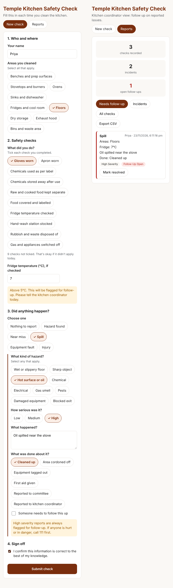

# Temple Kitchen Safety Check

A mobile-friendly health and safety form for volunteers who clean the kitchen at the Sri Balaji Temple in Hamilton, New Zealand, plus a protected reports page for the kitchen coordinator.

Volunteers tap selection boxes instead of typing, so a check takes about a minute on a phone. The coordinator sees every check, filters to the ones that need follow-up, marks them resolved and exports everything to CSV.



## What it does

- **Tap-to-select form:** areas cleaned, safety checks completed, fridge temperature, and whether anything happened (hazard, near miss, spill, equipment fault or injury).
- **Follow-up questions only when needed:** hazard type, severity, what happened and what was done appear only if something was reported.
- **Safety rules enforced on the server:** a fridge reading above 5°C or any high-severity incident is always flagged for follow-up, whatever the browser sends.
- **Coordinator reports at `/admin`:** totals, open follow-ups, incident filter, "Mark resolved" and CSV export, protected by Cloudflare Access.
- **Accessible:** selection boxes are real checkboxes and radio buttons, so they work with keyboards and screen readers.

## Architecture

```
Phone (React form)  ──POST /api/submit──────▶  Cloudflare Pages Functions  ──▶  Cloudflare D1 (SQLite)
Coordinator (/admin) ─GET/PATCH /api/reports─▶  (Access token checked)
```

- **Frontend:** React 19 + TypeScript, built with Vite, hosted on Cloudflare Pages.
- **API:** Cloudflare Pages Functions in `functions/`, with the logic in `server/`.
  - `POST /api/submit` is public, so volunteers don't need an account.
  - `GET /api/reports` and `PATCH /api/reports/:id` are for coordinators only.
- **Database:** Cloudflare D1, defined by SQL migrations in `migrations/`.
- **Validation:** `shared/reportRules.ts` is used by both the form and the API, so the rules can't drift apart. The API never trusts the browser: it re-checks types, allowed options, lengths and the incident rules, and rejects oversized or non-JSON requests.
- **Security:** Cloudflare Access protects `/admin` and `/api/reports`. The API also verifies the Access token (JWT) itself, in case the Access policy is ever misconfigured.
- **Tests:** Vitest. The API tests run against a real SQLite database built from the same migration that D1 uses.
- **CI:** GitHub Actions type-checks, tests and builds every push. Cloudflare Pages deploys `main` automatically.

```
src/                 React app (form, reports, demo-mode storage)
shared/              types, form options and validation rules used by app and API
server/              API handlers, D1 queries, Access token check
functions/api/       Cloudflare Pages Functions routes
migrations/          D1 schema
tests/               API, rules and storage tests
```

## Run it locally

Requires Node.js 22 or later.

```bash
npm install
npm test             # unit and API tests
npm run dev          # quick UI preview in demo mode (saves in your browser)
```

To run the full stack (API and a local D1 database) on your machine:

```bash
npm run db:migrate:local   # create the local database
npm run cf:dev             # build and serve at http://localhost:8788
```

## Deploy to Cloudflare

You need a free Cloudflare account and the Wrangler CLI (installed with `npm install`).

1. **Sign in:** `npx wrangler login`
2. **Create the database:** `npx wrangler d1 create temple-kitchen-safety`. Copy the `database_id` it prints into `wrangler.toml`.
3. **Create the table:** `npm run db:migrate:remote`
4. **Create the Pages project:** in the Cloudflare dashboard, go to **Workers & Pages > Create > Pages > Connect to Git** and pick this repository. Use:
   - Build command: `npm run build:cf`
   - Build output directory: `dist`
   - Environment variable: `NODE_VERSION` = `22`

   Pages reads the D1 binding from `wrangler.toml`. If the Functions can't find the database, add it under **Settings > Bindings > D1 database** with the variable name `DB`.
5. **Deploy:** push to `main`. The site goes live at `https://temple-kitchen-safety.pages.dev`.

## Protect the reports with Cloudflare Access

Until this step, anyone with the link can open `/admin`. That's fine for a demo but not for real use.

1. In **Zero Trust > Access > Applications**, add a **Self-hosted** application for your Pages domain, with these paths:
   - `/admin`
   - `/api/reports`
2. Add a policy allowing only the coordinators' email addresses, signing in with a one-time email PIN. This is free for up to 50 users.
3. Copy the application's **Audience (AUD) tag**.
4. In the Pages project, go to **Settings > Variables and Secrets** and add:
   - `ACCESS_TEAM_DOMAIN`, set to `your-team.cloudflareaccess.com`
   - `ACCESS_AUD`, set to the AUD tag
5. Redeploy. The API now rejects coordinator requests without a valid Access token.

## Customising

All checklist options live in `shared/formOptions.ts`. Edit the lists there and both the form and the API validation update together. Database changes go in a new numbered file in `migrations/`.
